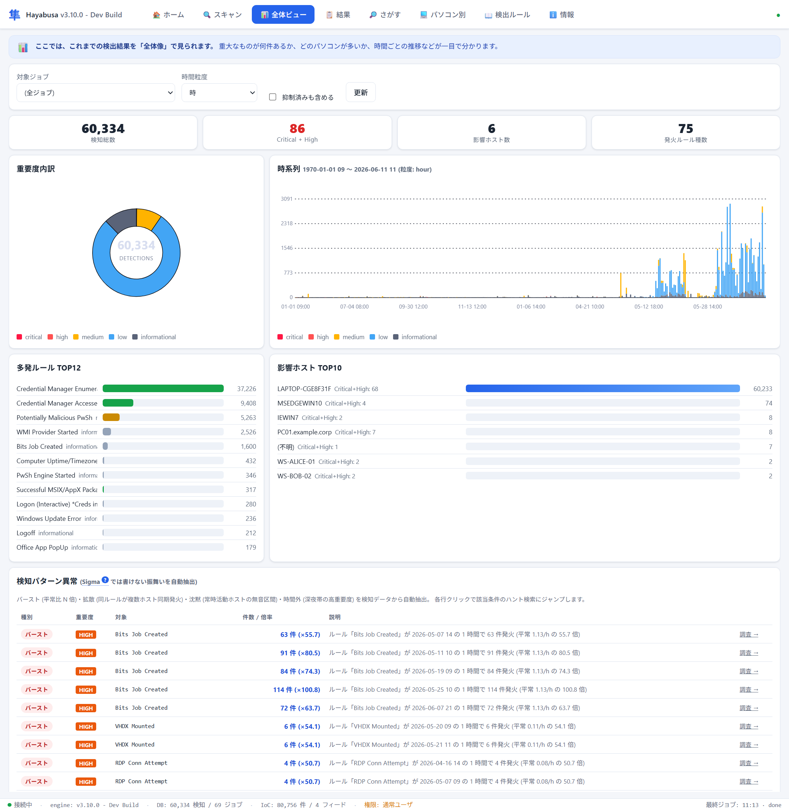
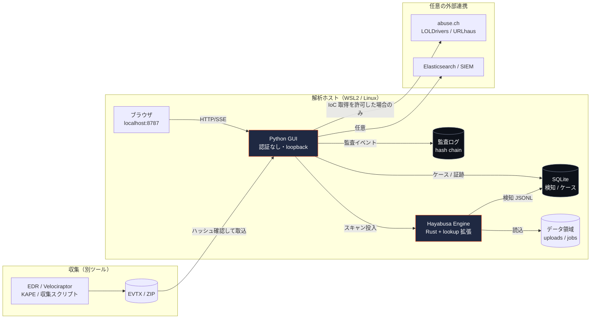
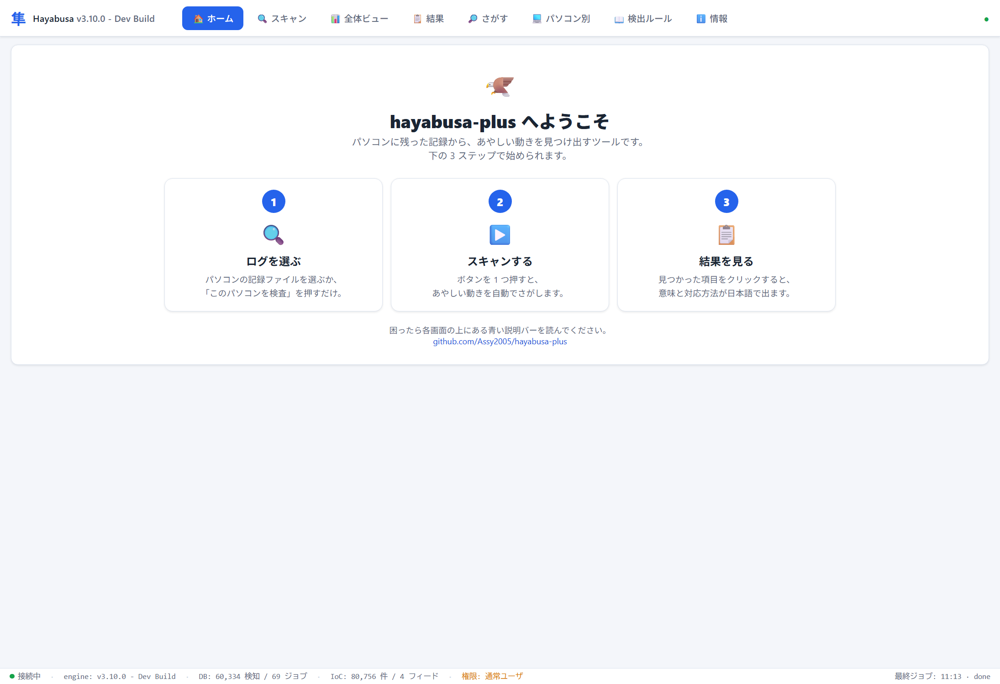
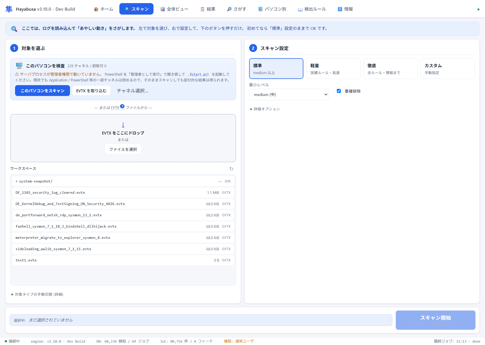
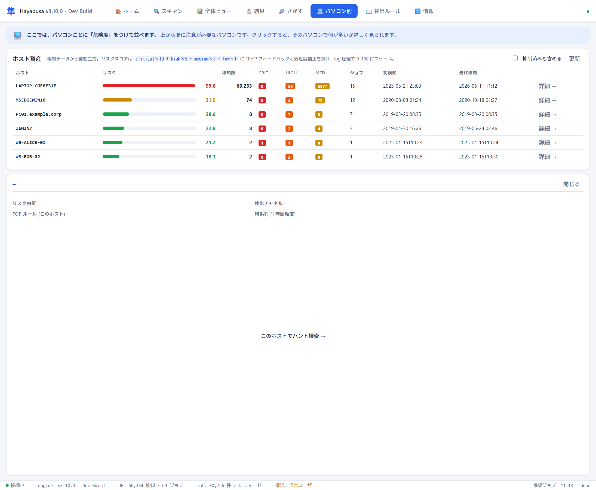
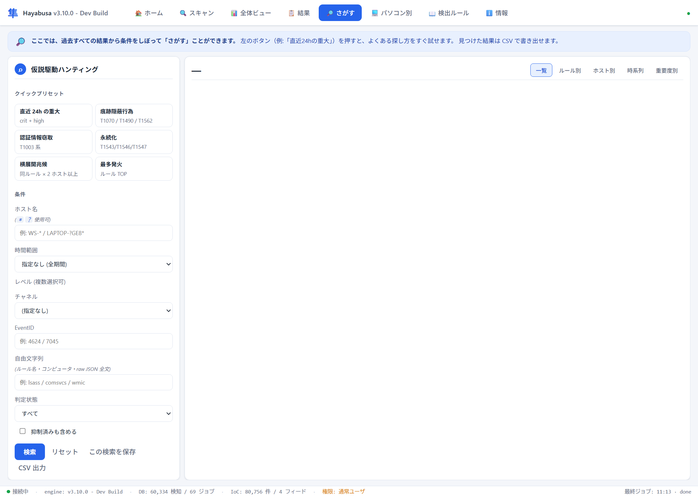

<div align="center">

# 🦅 hayabusa-plus

**隔離した解析ホストで使う、無料の企業内 DFIR コンソール**

Sigma 検知 + IoC 照合 + プロセスツリー + ケース / 証跡ハッシュ / 監査ログ。
WSL2・Linux ミニ PC・エアギャップ環境で、Python 標準ライブラリだけで動きます。


<br/>



</div>

---

## 📌 一行で

> **収集済み EVTX を隔離した解析ホストに取り込み、SHA-256 を記録してから、
> Sigma 検知・IoC 照合・時系列分析・ケース管理を一画面で行う無料の DFIR コンソール。**

解析対象の端末に常駐せず、USB 対 USB の持ち運びも前提にしません。
EDR / Velociraptor / KAPE などの収集結果を、WSL2 または Linux の専用ミニ PC で
深く読むための **解析面** です。

- 企業内運用の設計: [docs/ENTERPRISE-DFIR.md](docs/ENTERPRISE-DFIR.md)
- ゼロ依存: Python 3.10+ 標準ライブラリのみ（`pip` / `npm` 不要）
- 既定は localhost のみ。共有モードは明示 opt-in
- ケース / 証跡 / 監査ログはデータ領域に分離して保存

> ⚠️ **解析対象の端末上で実行しないでください。** ログは収集ツールで取得し、
> ハッシュを確認してから解析ホストへ取り込んでください。

---

## 🎯 解決したい問題

| 現場の課題 | hayabusa-plus のアプローチ |
|---|---|
| 侵害端末上で解析して証拠を汚す | **収集と解析を分離**。WSL2 / Linux の解析ホストで実行 |
| USB 対 USB でマルウェアを持ち運ぶ | 暗号化ネットワーク転送を前提。USB は最終手段 |
| どの証跡を読んだか説明できない | 取込時とスキャン前に **SHA-256 / manifest** を記録 |
| 案件が増えると結果が迷子になる | **ケース** にジョブ・証跡・監査履歴を集約 |
| 誰が何をしたか分からない | 追記専用の **ハッシュチェーン監査ログ** |
| Hayabusa CLI の結果が CSV/JSON の山 | SQLite に正規化し、多軸検索・ピボット・日本語解説 |
| Sigma 単体では見えない振舞い | バースト・拡散・沈黙・時間外を集計で抽出 |
| 商用 DFIR 製品は高価 | ケース・証跡・監査・レポートの縦線を無料で実装 |

---

## 🎯 解決したい問題

| 既存ツールの課題 | hayabusa-plus のアプローチ |
|---|---|
| Hayabusa CLI は強力だが結果は CSV/JSON の山。手で grep / Excel で開く運用 | 結果を **SQLite に正規化** → 多軸絞り込み + ピボット + CSV 出力 |
| ある検知を見ても **何が起きているか** が分かりにくい | 検知ごとに **「なに?」「重要度」「ATT&CK」「次にすべきこと」** をクリックで展開 |
| Sigma 単体だと 1 イベント単位の判定しかできない | **振舞い検知** (バースト・拡散・沈黙・時間外) を集計で抽出 |
| IoC フィードを取り込みたいがルール書き換えが面倒 | **`lookup:` 拡張** で外部ファイル参照、フィードは GUI/CLI から定期更新 |
| プロセスの系統が分からない | 検知発生時刻 ±N 分の Sysmon EID 1 から **親子ツリーを自動構築** |
| 「攻撃者はログを消す」前提が抜けがち | **痕跡隠蔽検知ルール 5 本** + ARCHITECTURE.md にアンチエヴェイジョン専用章 |

---

## ✨ 主な機能

<table>
<tr>
<td width="50%" valign="top">

### 🔎 解析・調査
- **EVTX / ZIP 取込** → ハッシュ記録 → スキャン
- **ケース / 証跡** — 案件名、参照番号、SHA-256、manifest、受領時刻
- **監査ログ** — 追記専用 JSONL + ハッシュチェーン検証
- **検知解説パネル** — 定義・誤検知例・ATT&CK 日本語・推奨次手
- **プロセスツリー再構築** — Sysmon EID 1 から親子ツリー
- **プロセス / ファイル関係図** — 検知のみ / ログ全体の2モード。起動・ファイル作成・ネットワーク接続を矢印で可視化
- **関係図の操作性** — 全画面表示、ホイールズーム、ドラッグ移動、ノード/関係線クリックで詳細ポップアップ
- **関係図フィルタ** — 種別・時間範囲・ノイズ除去、検索の前後移動、選択ノードへのフォーカス、SVG/PNG保存
- **通信先の可視化** — Sysmon EID 3/22、Security 5156 から接続先 IP / ホスト / ポート / DNS を表示
- **アカウント / 監査イベント** — 5136 / 4662 / 4719 / 4738 / 4702 / 1102 / 4742 を「実行者 → 対象」で表示

</td>
<td width="50%" valign="top">

### 🎯 ハンティング・運用
- **多軸検索** — ホスト glob / 時間範囲 / レベル / ルール / ATT&CK / EID / 自由文字列
- **6 個のクイック仮説プリセット** — 直近 24h 重大 / 痕跡隠蔽 / 認証情報窃取 / 永続化 / 横展開 / 最多発火
- **ピボットビュー** — ルール別 / ホスト別 / 時系列 / 重要度別
- **TP / FP フィードバック** — `lookups/fp_history/` に蓄積
- **抑制ルール** — ホスト × ルール単位、JSON でバージョン管理可
- **CSV エクスポート** — Excel 互換 (BOM 付き UTF-8)

</td>
</tr>
<tr>
<td valign="top">

### 📊 ダッシュボード
- KPI (検知総数 / Critical+High / 影響ホスト数 / 発火ルール種数)
- 重要度ドーナツ + 時系列スタック棒 (SVG、外部ライブラリ依存ゼロ)
- TOP ルール / TOP ホスト水平バー
- **検知パターン異常カード** — Sigma では書けない振舞いを自動抽出

</td>
<td valign="top">

### 🛡️ IoC フィード / 連携
- **4 フィード** 統合済 (LOLDrivers / MalwareBazaar / URLhaus / Feodo)
- **82,679 件の IoC** をワンクリックで取得
- 取得失敗時は **既存ファイル温存** (検知継続)
- GUI ボタン or `tools/fetch_feeds.py` 経由
- Elasticsearch / Kibana への検知投入（任意）

</td>
</tr>
</table>

---

## 🏗️ アーキテクチャ



### データの置き場所

| パス | 内容 | 既定 |
|---|---|---|
| `<data-root>/uploads/` | 取り込んだ EVTX / ZIP 展開先 | `./workspace/uploads` |
| `<data-root>/jobs/` | ジョブごとの JSONL / ログ / HTML サマリ | `./workspace/jobs` |
| `<data-root>/hayabusa-gui.sqlite` | 検知・ジョブ・ケース・証跡台帳 | `./workspace` |
| `<data-root>/audit/audit.jsonl` | 追記専用・ハッシュチェーン監査ログ | `./workspace/audit` |

`HAYABUSA_DATA_ROOT` でリポジトリ外の暗号化ボリュームに分離できます。

---

## 🖼️ 画面イメージ

> いずれもブラウザ (`http://127.0.0.1:8787`) 上で動作。外部ライブラリ・ビルド不要の素の HTML / CSS / SVG。

### 🏠 ホーム — 解析ホストの姿勢と 3 ステップ

実行環境・待受・証跡ハッシュ・認証の状態を表示し、「証跡を取り込む → ケースで解析する →
証跡を確認する」の流れを提示します。



### 🔍 スキャン — 証跡の取込から実行まで

EVTX / ZIP をドロップし、案件名を指定してスキャン。開始前に SHA-256（ディレクトリは
manifest）を記録します。プリセット、詳細オプション、進捗バー、中止ボタンも同じ画面です。



### 🗂️ ケース / 証跡 — 案件単位の追跡

ケースごとに証跡台帳、ジョブ、監査履歴を表示。監査ログのハッシュチェーンを UI から検証できます。

### 📊 全体ビュー — 検出結果の全体像をひと目で

KPI、重要度ドーナツ、時系列スタック棒、TOP ルール / TOP ホスト、そして Sigma では
書けない振舞い異常（バースト・拡散・沈黙・時間外）の自動抽出。


### 💻 ホスト別 — リスクスコアで優先順位を付ける

重要度・TP/FP・新しさ・ログ圧縮を加味した加重スコアで端末を並べます。
クリックでそのホストのハント検索へ。



### 🔎 さがす — 仮説駆動ハンティング

6 個のクイックプリセット + ホスト glob・時間・レベル・チャネル・EID・自由文字列の
多軸フィルタ。結果はルール別 / ホスト別 / 時系列 / 重要度別にピボット、CSV 出力も。



## 🚀 クイックスタート（WSL2 / Linux 推奨）

> 本番Linuxの systemd・TLS/OIDC・バックアップまで含めた手順は
> [docs/INSTALL-LINUX.md](docs/INSTALL-LINUX.md) を参照してください。

> Windows は互換ターゲットです。本番は WSL2 または Linux の解析ホストを推奨します。
> エンジンとルールが同梱されたリリースを使う場合、Rust ビルドは不要です。

### 1. 取得

```bash
git clone https://github.com/Assy2005/hayabusa-plus.git
cd hayabusa-plus
```

### 2. Hayabusa エンジン

```bash
# Linux 用エンジン (lookup 拡張入り) をビルド
bash tools/build_engine_linux.sh          # → bin/hayabusa-fx

# Sigma ルールが未取得なら取得し、custom ルールを再配置
./bin/hayabusa-fx update-rules -r ./bin/rules
bash tools/build_engine_linux.sh
```

### 3. カスタムルール + IoC フィード（任意）

```bash
mkdir -p bin/rules/hayabusa/custom
cp rules-custom/*.yml bin/rules/hayabusa/custom/
python3 tools/fetch_feeds.py             # 約 8 万件。外向き通信を許可した場合のみ
```

### 4. 起動

```bash
DATA_ROOT="$HOME/dfir-data" ./start.sh --open
# 既定: http://127.0.0.1:8787
```

`DATA_ROOT` は証跡用の ext4 / 暗号化ボリュームを指定してください。
WSL2 の `/mnt/c/...` は遅く、Windows 側からも見えるため、証跡保管には向きません。

### Windows（互換モード）

```powershell
.\start.ps1 -DataRoot D:\dfir-data
```

Windows は互換ターゲットです。解析ホスト自身のログを直接読む機能は持たず、
収集済みの EVTX / ZIP を取り込んでスキャンします。

### 🌐 共有モード（認証なし・明示 opt-in）

勉強会・閉域ラボで「危険度ランキング」を LAN に出す場合だけ使用します。認証はありません。

```bash
# Linux / WSL
HAYABUSA_ALLOW_UNAUTHENTICATED=1 ./start.sh --shared

# Windows
$env:HAYABUSA_ALLOW_UNAUTHENTICATED='1'; .\start.ps1 -Public
```

> ⚠️ 共有モードで LAN からできるのは **アップロード・スキャン・ランキング閲覧** だけです。
> ケース、証跡台帳、監査ログ、ジョブ一覧、検知詳細、ホスト情報は loopback（解析ホスト）限定で、
> 匿名クライアントには返しません。それでも認証はないため、インターネットに公開しないでください。
> 企業運用では localhost のまま、VPN / 認証付きリバースプロキシ / 踏み台の内側に置きます。
> 詳細は [docs/ENTERPRISE-DFIR.md](docs/ENTERPRISE-DFIR.md)。

---

## 🔧 エンジン拡張: `lookup:`

upstream Hayabusa に **外部 IoC ファイル参照** の機能を追加しました。ルール 1 行で 8 万件のフィードを参照できます。

```yaml
title: Known vulnerable driver loaded (LOLDrivers hash match)
lookup:
  - name: lol_drivers
    file: ../../../../lookups/loldrivers.txt        # ← 1,924 件の SHA-256
detection:
  sel:
    Channel: 'Microsoft-Windows-Sysmon/Operational'
    EventID: 6
    Hashes|lookup: lol_drivers                       # ← 部分一致で発火
  condition: sel
level: critical
```

エンジン側の主な変更:
- `engine/src/detections/rule/lookup.rs` (新規) — 起動時にロード、`RwLock<HashMap>` でキャッシュ
- `engine/src/detections/rule/matchers.rs` — `PipeElement::Lookup` / `NotLookup` 追加
- `engine/src/yaml.rs` — `lookup:` ブロックを認識して登録
- Windows-GNU ビルド対応 (mimalloc 依存除外)

---

## 📚 同梱検知ルール

`rules-custom/` に **53 本の高精度ルール** を同梱。攻撃者が“やりたいこと”を保ったまま避けるのが難しい特徴を、複数組み合わせて (AND 条件) 検知することで誤検知を抑えています。2026年の ClickFix / RMM 悪用 / Defender 改ざん / BYOVD 周辺も収録しています。

| カテゴリ | ルール | 重要度 | 何を見ているか |
|---|---|---|---|
| 🔓 認証情報の窃取 | `lsass_comsvcs_minidump` | critical | ログイン中のパスワード情報 (LSASS) をファイルに吸い出す手口 |
| 💀 居座り (永続化) | `service_install_userwritable_path` | high | 誰でも書き換えられる場所のプログラムをサービス登録して常駐させる |
| 💀 居座り (永続化) | `wmi_persistence_filter_to_consumer` | high | WMI を使い「特定の出来事をきっかけに自動実行」を仕込む |
| 🛡️ 防御の回避 | `amsi_patch_triad` | high | PowerShell のウイルス検査 (AMSI) を無力化する |
| 🌐 外部からの持ち込み | `certutil_remote_fetch` | critical | 正規ツール certutil を悪用して外部からファイルを取得する |
| 🧹 痕跡隠蔽 | `af_wevtutil_clear` | high | wevtutil などでイベントログをまるごと消去する |
| 🧹 痕跡隠蔽 | `af_eventlog_service_tamper` | critical | ログを記録するサービスそのものを停止・無効化する |
| 🧹 痕跡隠蔽 | `af_auditpol_reset` | high | auditpol による監査ポリシーの消去・削除 |
| 🧹 痕跡隠蔽 | `af_vss_shadow_deletion` | critical | 復元用スナップショットの削除 (ランサムの前兆) |
| 🧹 痕跡隠蔽 | `af_audit_policy_weakened` | high | 監査設定から記録項目を外して“見えなく”する |
| 🦠 IoC 照合 | `lookup_loldriver_load` | critical | 悪用が知られた脆弱ドライバの読み込み (LOLDrivers 一致) |
| 🦠 BYOVD | `byovd_driver_user_path` | medium | ユーザー書込可能な場所から読み込まれるカーネルドライバ |
| 🦠 IoC 照合 | `lookup_malware_hash` | critical | 既知のマルウェアそのものの実行 (MalwareBazaar 一致) |
| 🦠 IoC 照合 | `lookup_c2_url` | critical | 攻撃者の指令サーバとして知られる URL への通信 (URLhaus 一致) |
| 🪝 ClickFix | `clickfix_runmru` | high | Run ダイアログ経由の PowerShell / mshta / URL 実行 |
| 🪝 ClickFix | `clickfix_pcalua` | high | pcalua.exe を踏み台にした mshta / shell 起動 |
| 🪝 ClickFix | `clickfix_explorer_child` | high | Explorer / Windows Terminal 配下の難読化インタプリタ起動 |
| 🖥️ RMM 悪用 | `rmm_suspicious_deployment` | high | AnyDesk / ScreenConnect / MSP360 などの不審な導入・起動 |
| 🛡️ Defender 改ざん | `defender_exclusion_tamper` | high | Defender 除外パス追加・リアルタイム保護の弱体化 |
| 🌐 横展開 | `wmiexec_admin_share` | high | WmiPrvSE から ADMIN$ へ出力する WMIExec |
| ☁️ 持ち出し | `rclone_exfil` | medium | rclone による外部ストレージへの copy / sync |
| 🕵️ 認証情報 | `browser_credential_copy` | medium | esentutl によるブラウザ資格情報 DB のコピー |

各ルールには `falsepositives` と `references` を記載しています。詳細は [rules-custom/README.md](rules-custom/README.md)。

### 動作確認用サンプル EVTX

新しい検知ルールの確認用に、合成 EVTX と negative control を同梱しています。

- `samples/rule-tests/hayfx-2026-detections.evtx` — 12個の検知対象イベント
- `samples/rule-tests/hayfx-negative-control.evtx` — 正常系（新規ルール 0 検知）
- `samples/rule-tests/README.md` — 期待されるルールと確認手順
- `tools/check_rule_samples.py` — サンプルと期待値の自動照合

```bash
python tools/check_rule_samples.py
```

---

## 🛠️ 技術スタック

<div>


</div>

| 層 | 採用技術 | 依存 |
|---|---|---|
| エンジン | Rust 1.95 (fork hayabusa 3.10-dev) | rustls / aho-corasick / serde |
| バックエンド | Python 3.10+ 標準ライブラリのみ | 外部 pip 依存ゼロ |
| DB | SQLite (WAL モード) | Python `sqlite3` |
| フロント | Vanilla JS / SVG / 純 CSS | ビルドステップなし、フレームワーク無し |

意識して **外部依存を最小** に保っています。`pip install` 不要、`npm install` 不要、`make` 不要。Python 3.10+ と同梱エンジンがあれば `git clone → ./start.sh` で動きます。

---

## 🧭 設計思想

詳細は [ARCHITECTURE.md](ARCHITECTURE.md) (30 章)。要点だけ:

> **1. 解析対象端末で動かさない**
> 収集は EDR / Velociraptor / KAPE / 既存スクリプトに任せ、解析は隔離ホストで行う。

> **2. 収集と解析の責任分離**
> 本ツールは「来たログから最大限を絞り出す」ことに集中し、遠隔収集エージェントは作らない。

> **3. 証跡を先に固定する**
> 取込時とスキャン前に SHA-256 / manifest を記録し、解析結果と証跡を結びつける。

> **4. 沈黙も読む**
> リアルタイム検知ができない代わり、**時系列ギャップ** や **EID 比率の異常** を事後解析で検知。

> **5. 再現性と説明可能性**
> 同じ EVTX + 同じルールセット + 同じバージョン = 同じ出力。判断と操作は監査ログに残す。

---

## 🗺️ ロードマップ

成熟度モデルでの目標: **FY26 = Active Defense ③ / 中長期 = Intelligence ④**

| ステータス | ステップ | 内容 | 成熟度層 |
|---|---|---|---|
| ✅ | 1 | SQLite 結果ストア + TP/FP フィードバック | II. 詳細ログ解析 |
| ✅ | 2 | 抑制ルール + フィルタパック | III. マネジメント |
| ✅ | 3 | `lookup:` Sigma 拡張 (Rust) | I. 検知ルール最適化 |
| ✅ | 4 | アンチフォレンジック検知ルール 5 本 | I. ログ監視 |
| ✅ | 5 | 検知詳細解説 (ATT&CK 日本語 + 次手) | II. 詳細ログ解析 |
| ✅ | 6 | スレットハンティング検索 UI | I. **スレットハンティング** |
| ✅ | 7 | プロセスツリー可視化 | II. **フォレンジック** |
| ✅ | 8 | 振舞い検知 (バースト/拡散/沈黙/時間外) | I. **振舞い検知** |
| ✅ | 9 | IoC フィード自動取込 (LOLDrivers / abuse.ch) | IV. **OSINT / IoC** |
| ✅ | 10 | ホスト資産ビュー (リスクスコア順) | III. マネジメント |
| ⏳ | 11 | アラート分析の高度化 (週次レポート / ヒートマップ) | III. マネジメント |
| ⏳ | 12 | `correlate:` Sigma 拡張 (時系列相関) | I. 振舞い検知 (高度) |
| ⏳ | 13 | `behavioral:` Sigma 拡張 (rate gap analysis) | I. 振舞い検知 (高度) |
| ⏳ | 14 | AI 補助ルール生成 (TTP → Sigma) | 検知エンジニアリング |

---

## 🔄 upstream との同期

`Yamato-Security/hayabusa` の最新を取り込みたいとき:

```bash
git fetch upstream
git log --oneline main..upstream/main -- 'src/**'   # 差分確認

# エンジン側だけ取り込みたいとき (個別ファイル単位):
git show upstream/main:src/foo.rs > engine/src/foo.rs
```

`upstream` リモートは初回 clone 時に登録済みです。

---

## 📂 ディレクトリ構成

<details>
<summary>展開する</summary>

```
hayabusa-plus/
├── engine/                       # Hayabusa Rust 本体 (fork)
│   ├── src/detections/rule/
│   │   ├── lookup.rs             # ★ lookup: 拡張本体
│   │   └── matchers.rs           # PipeElement::Lookup 追加
│   └── ...                       # upstream のソースツリー
│
├── gui/                          # Python 製ローカル GUI
│   ├── server.py                 # HTTP/SSE サーバ / ケース・証跡 API
│   ├── store.py                  # SQLite 結果・ケース・証跡ストア
│   ├── audit.py                  # 追記専用ハッシュチェーン監査ログ
│   ├── behavioral.py             # 振舞い異常分析
│   ├── feed_fetcher.py           # IoC フィード取得
│   ├── process_tree.py           # プロセスツリー再構築
│   ├── rule_index.py             # RuleID → YAML 逆引き
│   └── static/                   # HTML / CSS / JS
│
├── rules-custom/                 # 自作 Sigma ルール (31 本)
├── lookups/                      # IoC フィード保存先
│   ├── feeds.yml                 # 取得対象マニフェスト
│   └── *.txt                     # フィードデータ (gitignore)
├── suppressions/                 # 抑制ルールスナップショット
├── docs/ENTERPRISE-DFIR.md       # 企業内運用・参照アーキテクチャ
├── tools/fetch_feeds.py          # フィード取得 CLI
├── ARCHITECTURE.md               # 設計書
├── README.md                     # この文書
├── start.sh                      # WSL2 / Linux ランチャ (推奨)
└── start.ps1                     # Windows 互換ランチャ
```

データ領域（既定 `workspace/`）:

```
workspace/
├── uploads/                      # 取り込んだ EVTX / ZIP 展開先
├── jobs/<job-id>/                # JSONL / stdout / stderr / summary.html
├── audit/audit.jsonl             # 監査ログ (hash chain)
└── hayabusa-gui.sqlite           # 検知・ジョブ・ケース・証跡
```

</details>

---

## 🧪 検知カバレッジ

`sbousseaden/evtx-attack-samples` の攻撃サンプルを使って、検知ルールのカバレッジを測定できます。

```bash
python3 tools/evtx_sample_coverage.py \
  --dataset ~/evtx-attack-samples \
  --workers 4 \
  --min-level low
```

現在のサンプルカバレッジは **269 / 278（96.8%）** です。詳細は [docs/DETECTION-COVERAGE.md](docs/DETECTION-COVERAGE.md) を参照してください。

---

## 🔐 セキュリティに関する注意

- **既定は localhost (127.0.0.1) のみ**。共有モードは `HAYABUSA_ALLOW_UNAUTHENTICATED=1` が必須
- 共有モードの LAN クライアントは **アップロード・スキャン・ランキングのみ**。ケース / 証跡 / 監査 / ジョブ / 検知詳細 / ホスト情報は loopback 限定
- **認証なし** / 単一ホスト前提。企業のチーム利用では VPN・認証付きリバースプロキシ・踏み台の内側に置く
- データ領域は `HAYABUSA_DATA_ROOT` で分離可能。`umask 077` で作成し、共有フォルダや OneDrive を避ける
- 監査ログはハッシュチェーンで改ざんを検知できるが、ホスト全体を支配された場合の完全防御ではない。外部 SIEM / WORM へエクスポートする
- **取込専用**。解析ホスト自身のイベントログを直接読む機能は持たない。収集済みの EVTX / ZIP のみを取り込む
- アップロードファイル名は検証し、パスはデータ領域配下に限定（パストラバーサル防止）
- Hayabusa CLI 引数は GUI 側のホワイトリストから組み立て。ブラウザから任意のフラグを差し込むことは不可能

---

## 📊 数字で見る hayabusa-plus

| メトリック | 値 |
|---|---|
| 自作 Sigma ルール | **53 本** (critical 7 / high 26 / medium 15 / low 5) |
| エンジン拡張 LoC | 約 **400 行** (Rust) |
| GUI コード LoC | 約 **3,300 行** (Python + JS + CSS) |
| 外部 pip / npm 依存 | **0** |
| 統合 IoC フィード | **4** (合計 **82,679 件** の IoC) |
| 検知データの保管 | SQLite + 元 JSONL (二重) |
| 設計書 (ARCHITECTURE.md) | **30 章 / 約 2,400 行** |

---

## 📜 ライセンス

- `engine/` 配下: 上流 Hayabusa の [GPL-3.0](engine/LICENSE.txt) を継承
- それ以外 (gui / rules-custom / docs): 同じく **GPL-3.0**

## 🙏 謝辞

- [**Yamato Security**](https://github.com/Yamato-Security/) — Hayabusa 本体。素晴らしい基盤に乗せていただきました
- [**SigmaHQ**](https://github.com/SigmaHQ/sigma) — Sigma ルール仕様
- [**LOLDrivers**](https://www.loldrivers.io/) — 脆弱ドライバフィード
- [**abuse.ch**](https://abuse.ch/) — MalwareBazaar / URLhaus / Feodo Tracker
- [**MITRE ATT&CK**](https://attack.mitre.org/) — 戦術・技術分類

---

<div align="center">

**[⬆ 上へ戻る](#-hayabusa-plus)**

Made with detection engineering depth, not marketing fluff.

</div>
