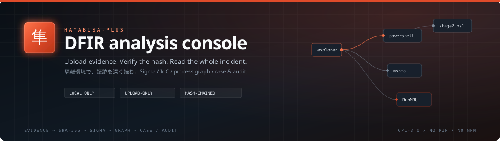
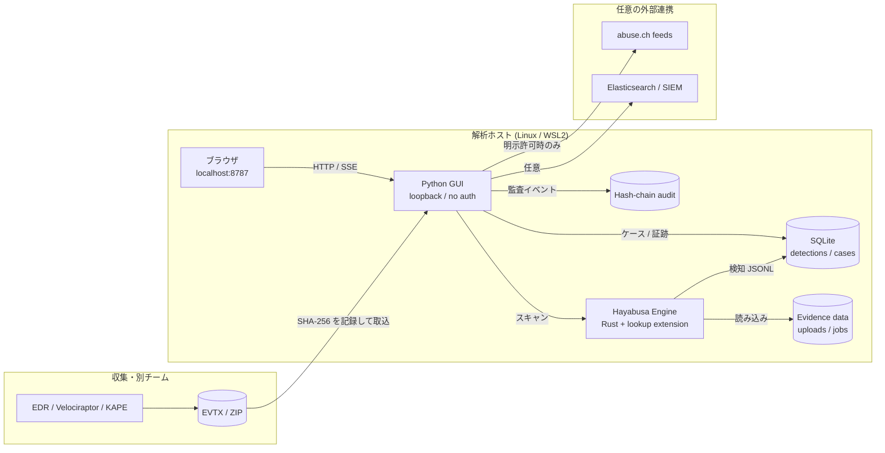

<div align="center">



<br/><br/>

[](https://github.com/Assy2005/hayabusa-plus)
[](https://www.python.org/)
[](https://www.rust-lang.org/)
[](docs/INSTALL-LINUX.md)
[](https://github.com/Assy2005/hayabusa-plus)
[](engine/LICENSE.txt)

**収集済み EVTX を、隔離環境で深く読む。**<br/>
Sigma 検知 / IoC / プロセス・ファイル関係図 / ケース・証跡・監査を、<br/>
Linux・WSL2・オフライン環境で扱う無料の DFIR コンソールです。

[**クイックスタート**](#クイックスタートlinux--proxmox) ·
[**検知ルール**](#同梱ルールの例) ·
[**画面**](#画面イメージ) ·
[**Linux 本番**](docs/INSTALL-LINUX.md) ·
[**設計**](ARCHITECTURE.md)

</div>

<table align="center">
<tr>
<td align="center" width="25%"><h3>53</h3><sub>Sigma rules</sub></td>
<td align="center" width="25%"><h3>269 / 278</h3><sub>sample coverage</sub></td>
<td align="center" width="25%"><h3>12 / 0</h3><sub>positive / negative fixtures</sub></td>
<td align="center" width="25%"><h3>0</h3><sub>pip / npm dependencies</sub></td>
</tr>
</table>

> [!IMPORTANT]
> **解析対象の端末では実行しないでください。**<br/>
> 収集済みの EVTX / ZIP を解析ホストへ取り込み、SHA-256 を記録してから検査します。
> 既定の待受は `127.0.0.1` のみで、認証はありません。LAN 公開は明示 opt-in です。

---

## 何を解決するか

| 現場の課題 | hayabusa-plus のアプローチ |
|---|---|
| 侵害端末上で解析して証拠を汚す | 収集と解析を分離。WSL2 / Linux の専用ホストで実行 |
| どの証跡を読んだか説明できない | 取り込み時とスキャン前に SHA-256 / manifest を記録 |
| 案件が増えると結果が迷子になる | ケースにジョブ・証跡・判定・監査履歴を集約 |
| 誰が何をしたか追えない | 追記専用・ハッシュチェーン監査ログ |
| Hayabusa の結果が CSV / JSON の山になる | SQLite に正規化し、多軸検索・ピボット・日本語解説 |
| Sigma 単体では攻撃の流れが見えない | プロセスツリー・関係図・時系列・振る舞い差分で補完 |
| 商用 DFIR 製品は高価 | ケース・証跡・監査・レポートの縦線を無料で実装 |

---

## 一行で

> 収集済みの EVTX / ZIP を解析ホストに取り込み、SHA-256 を記録してから、
> Sigma 検知・IoC 照合・時系列調査・関係図・ケース管理を一画面で行う DFIR コンソールです。

**解析対象の端末には常駐しません。** EDR / Velociraptor / KAPE などで収集したログを、
WSL2 または Linux の専用解析ホストへ持ち込んで調査します。

- 企業向けの設計メモ: [docs/ENTERPRISE-DFIR.md](docs/ENTERPRISE-DFIR.md)
- Linux 本番手順: [docs/INSTALL-LINUX.md](docs/INSTALL-LINUX.md)
- 検知カバレッジ: [docs/DETECTION-COVERAGE.md](docs/DETECTION-COVERAGE.md)
- 設計書: [ARCHITECTURE.md](ARCHITECTURE.md)

> **解析対象端末で実行しないでください。** ログは収集ツールで取得し、
> ハッシュを確認してから解析ホストへ取り込んでください。

---

## 主な特徴

### 1. 証跡を壊さず、説明できる

- EVTX / ZIP のアップロード取り込み（解析対象の直接読み取りは行わない）
- 取り込み時とスキャン前に **SHA-256 / manifest** を記録
- ケース単位で証跡・ジョブ・検知・判定をまとめて追跡
- 追記専用 JSONL の **ハッシュチェーン監査ログ**
- 既定は `127.0.0.1` のみ。共有モードは明示 opt-in

### 2. 検知結果を“読める”形にする

- Hayabusa の検知を SQLite に正規化
- ルール名・重要度・ATT&CK・日本語解説・推奨アクション
- ルール / ホスト / 時系列 / 重要度 / チャネル / EID での多軸検索
- TP / FP フィードバックと抑制ルール
- CSV エクスポート（Excel 互換 UTF-8）

### 3. プロセス・ファイル・ネットワークの関係を見る

- Sysmon EID 1 / Security 4688 からプロセスツリーを再構築
- Sysmon EID 11 / 15 のファイル作成、EID 3 / 22 / Security 5156 の通信を表示
- 関係図は **検知のみ / ログ全体** の2モード
- 起動・作成・接続・監査イベントを矢印で追跡
- ズーム、ドラッグ移動、全画面、検索、フィルタ、SVG / PNG 保存
- ノードや関係線をクリックして詳細を確認

### 4. 2026年の手口を意識したルール群

`rules-custom/` に **53本**の高精度ルールを同梱しています。

- ClickFix / 偽CAPTCHA / `pcalua.exe` 経由の実行
- RMM 悪用（AnyDesk / ScreenConnect / MSP360 / Splashtop / Atera / TeamViewer / RustDesk）
- Defender 除外追加・リアルタイム保護の弱体化
- BYOVD（ユーザー領域から読み込まれるカーネルドライバ）
- WMIExec の `ADMIN$` 出力
- cloudflared の `svchost.exe` 偽装
- rclone による外部持ち出し
- ブラウザ資格情報 DB のコピー
- SMB / IPC$ / RDP / WinRM / DCOM / BITS / 監査ポリシー変更 など

ルールは [rules-custom/](rules-custom/) にあります。
GUI のスキャンで使う場合は `bin/rules/hayabusa/custom/` にコピーします。

```bash
cp -f rules-custom/*.yml bin/rules/hayabusa/custom/
```

### 5. 動作確認用サンプル付き

検知ルール専用の合成 EVTX と、正常系の negative control を同梱しています。

- [samples/rule-tests/hayfx-2026-detections.evtx](samples/rule-tests/hayfx-2026-detections.evtx)
  - 12イベント / 12検知
- [samples/rule-tests/hayfx-negative-control.evtx](samples/rule-tests/hayfx-negative-control.evtx)
  - 新規ルール 0検知
- [samples/rule-tests/README.md](samples/rule-tests/README.md)

```bash
python tools/check_rule_samples.py
```

```text
positive: 12/12 expected rules fired
negative: 0 unexpected new-rule detections

OK: samples match expected detections
```

> [!TIP]
> GUI で確認する場合は `hayfx-2026-detections.evtx` をスキャンし、
> 12イベント / 12検知になることを確認してください。詳細は
> [samples/rule-tests/README.md](samples/rule-tests/README.md) にあります。

---

## クイックスタート（Linux / Proxmox）

前提: Python 3.10 以上。アプリ本体に `pip` / `npm` の依存はありません。

```bash
git clone https://github.com/Assy2005/hayabusa-plus.git
cd hayabusa-plus

# 証跡はリポジトリ外の ext4 / 暗号化ボリュームへ
DATA_ROOT=/srv/dfir-data ./start.sh
```

ブラウザは解析ホスト上で開くか、SSH ポート転送で接続します。

```bash
ssh -N -L 8787:127.0.0.1:8787 user@analysis-host
# 手元のブラウザで http://127.0.0.1:8787
```

Proxmox では LXC より **Ubuntu 24.04 の VM** を推奨します。証跡用ディスクは
LUKS + ext4 で暗号化し、`DATA_ROOT` をそのボリュームへ向けてください。

### Linux 本番（systemd / TLS / OIDC / バックアップ）

Proxmox 上で常設する場合は、こちらの手順を使用してください。

- [docs/INSTALL-LINUX.md](docs/INSTALL-LINUX.md)
- systemd サービス: `deploy/hayabusa-plus.service`
- 環境変数: `deploy/hayabusa-plus.env.example`
- Nginx + OIDC 例: `deploy/nginx-hayabusa-plus.conf.example`

本番では以下を推奨します。

- アプリは `127.0.0.1` のみで待受
- 証跡は LUKS 暗号化された ext4 上に保存
- チーム利用は Nginx + OIDC などの認証付きリバースプロキシの内側
- 8787 を LAN / インターネットへ直接公開しない
- 監査ログを外部 SIEM / WORM へエクスポート

### WSL2 / Windows 互換モード

```bash
# WSL2
DATA_ROOT="$HOME/dfir-data" ./start.sh --open
```

```powershell
# Windows は互換ターゲット
.\start.ps1 -DataRoot D:\dfir-data
```

Windows でも解析対象端末のログを直接読む機能は持たず、収集済み EVTX / ZIP のみを取り込みます。

### エンジンを再ビルドする場合

同梱の `bin/hayabusa-fx` を使わず、Rust でビルドする場合:

```bash
bash tools/build_engine_linux.sh
./bin/hayabusa-fx update-rules -r ./bin/rules
cp -f rules-custom/*.yml bin/rules/hayabusa/custom/
```

---

## 共有モード（認証なし・明示 opt-in）

勉強会や閉域ラボで「危険度ランキング」を LAN に出す場合だけ使用します。
認証はありません。

```bash
# Linux / WSL
HAYABUSA_ALLOW_UNAUTHENTICATED=1 ./start.sh --shared

# Windows
$env:HAYABUSA_ALLOW_UNAUTHENTICATED='1'; .\start.ps1 -Public
```

> 共有モードで LAN からできるのは **アップロード・スキャン・ランキング閲覧** だけです。
> ケース、証跡台帳、監査ログ、ジョブ一覧、検知詳細、ホスト情報は loopback 限定です。
> それでも認証はないため、インターネットへ公開しないでください。

---

## アーキテクチャ



### データの置き場所

| パス | 内容 | 既定 |
|---|---|---|
| `<data-root>/uploads/` | 取り込んだ EVTX / ZIP 展開先 | `./workspace/uploads` |
| `<data-root>/jobs/` | ジョブごとの JSONL / ログ / HTML サマリ | `./workspace/jobs` |
| `<data-root>/hayabusa-gui.sqlite` | 検知・ジョブ・ケース・証跡台帳 | `./workspace` |
| `<data-root>/audit/audit.jsonl` | 追記専用・ハッシュチェーン監査ログ | `./workspace/audit` |

`HAYABUSA_DATA_ROOT` でリポジトリ外の暗号化ボリュームへ分離できます。

---

## 画面イメージ

<table>
<tr>
<td width="50%" valign="top">

<br/>
<b>ホーム</b><br/>
<sub>実行環境・証跡ハッシュ・認証状態と、解析までの流れ。</sub>
</td>
<td width="50%" valign="top">

<br/>
<b>スキャン</b><br/>
<sub>EVTX / ZIP の取り込み、プリセット、進捗、中止。</sub>
</td>
</tr>
<tr>
<td width="50%" valign="top">

<br/>
<b>ダッシュボード</b><br/>
<sub>KPI、重要度、時系列、TOP ルール / ホスト。</sub>
</td>
<td width="50%" valign="top">

<br/>
<b>ハンティング</b><br/>
<sub>ホスト glob、期間、レベル、EID、自由文字列で検索。</sub>
</td>
</tr>
</table>

<p align="center">

<br/>
<sub><b>ホスト別ビュー</b> — 重要度・TP/FP・新しさを加味したリスクスコア</sub>
</p>

### プロセス / ファイル関係図

検知のみ / ログ全体を切り替え、プロセスの起動・ファイル作成・ネットワーク接続を表示します。
関係線やノードをクリックすると、実行ファイル・コマンドライン・接続先をその場で確認できます。

- 検知のみ: ルールにヒットしたプロセスとファイルを追跡
- ログ全体: 対象 EVTX に含まれるプロセス作成・ファイル作成・接続を丸ごと表示
- ドラッグ移動、Ctrl + ホイールズーム、検索、フィルタ、SVG / PNG 保存

---

## 同梱ルールの例

| カテゴリ | ルール例 | 重要度 |
|---|---|---|
| 認証情報窃取 | `lsass_comsvcs_minidump`, `browser_credential_copy` | critical / medium |
| 永続化 | `service_install_userwritable_path`, `wmi_persistence_filter_to_consumer` | high |
| 防御回避 | `amsi_patch_triad`, `defender_exclusion_tamper` | high |
| ClickFix | `clickfix_runmru`, `clickfix_pcalua`, `clickfix_explorer_child` | high |
| RMM 悪用 | `rmm_suspicious_deployment` | high |
| BYOVD | `byovd_driver_user_path`, `lookup_loldriver_load` | medium / critical |
| 横展開 | `wmiexec_admin_share`, `winrm_remote_management`, `5145_*` | high / medium |
| 痕跡隠蔽 | `af_wevtutil_clear`, `af_auditpol_reset`, `af_vss_shadow_deletion` | high / critical |
| 持ち出し | `rclone_exfil`, `bits_external_download` | medium / high |
| IoC 照合 | `lookup_malware_hash`, `lookup_c2_url` | critical |

全ルールには `falsepositives` と `references` を記載しています。
詳細は [rules-custom/README.md](rules-custom/README.md) を参照してください。

### 検知カバレッジ

`sbousseaden/evtx-attack-samples` の攻撃サンプルで継続的に測定しています。

```bash
python3 tools/evtx_sample_coverage.py \
  --dataset ~/evtx-attack-samples \
  --workers 4 \
  --min-level low
```

現在の測定値は **269 / 278（96.8%）** です。
未検知サンプルや測定方法は [docs/DETECTION-COVERAGE.md](docs/DETECTION-COVERAGE.md) に記載しています。

> カバレッジは「検知できたサンプル数」であり、誤検知の少なさを保証するものではありません。
> 実運用前にクリーンな基準ログで FP を確認してください。

---

## 技術スタック

| 層 | 技術 | 依存 |
|---|---|---|
| エンジン | Rust 1.95（Hayabusa fork 3.10-dev） | rustls / aho-corasick / serde |
| バックエンド | Python 3.10+ 標準ライブラリのみ | 外部 pip 依存なし |
| DB | SQLite（WAL モード） | Python `sqlite3` |
| フロントエンド | Vanilla JS / HTML / CSS / SVG | ビルド不要 |

`pip install` も `npm install` も不要です。Python 3.10+ と同梱エンジンがあれば、
`git clone` して `./start.sh` で起動できます。

---

## セキュリティ上の注意

- 既定は **localhost（127.0.0.1）のみ**
- 共有モードは `HAYABUSA_ALLOW_UNAUTHENTICATED=1` が必須
- ケース / 証跡 / 監査 / ジョブ / 検知詳細 / ホスト情報は loopback 限定
- 認証なし・単一ホスト前提。チーム利用は VPN / 認証付きリバースプロキシ / 踏み台の内側に置く
- データ領域は `HAYABUSA_DATA_ROOT` で分離し、`umask 077` で作成する
- 監査ログはハッシュチェーンで改ざんを検知できるが、ホスト全体の侵害には完全防御ではない。外部 SIEM / WORM へエクスポートする
- アップロードはパス・ファイル名を検証し、データ領域配下に限定する
- Hayabusa CLI 引数は GUI 側のホワイトリストから組み立てる

---

## ディレクトリ構成

```text
hayabusa-plus/
├── engine/                       # Hayabusa Rust 本体 (fork)
├── gui/                          # Python ローカル GUI
│   ├── server.py                 # HTTP / SSE / API
│   ├── store.py                  # SQLite 結果・ケース・証跡
│   ├── audit.py                  # ハッシュチェーン監査ログ
│   ├── relationship_graph.py     # 関係図ビルダー
│   ├── extras.py                 # 生ログ / Elastic / 関係図入力
│   └── static/                   # HTML / CSS / JS
├── rules-custom/                 # 自作 Sigma ルール 53本
├── bin/
│   ├── hayabusa-fx               # 同梱 Linux エンジン
│   └── rules/                    # 標準 + custom ルール
├── samples/rule-tests/           # 動作確認用 EVTX
├── tools/
│   ├── check_rule_samples.py     # サンプル自動チェッカー
│   ├── evtx_sample_coverage.py   # カバレッジ測定
│   └── fetch_feeds.py            # IoC フィード取得
├── deploy/                       # systemd / env / nginx テンプレート
├── docs/
│   ├── INSTALL-LINUX.md
│   ├── ENTERPRISE-DFIR.md
│   └── DETECTION-COVERAGE.md
├── ARCHITECTURE.md
├── start.sh
└── start.ps1
```

データ領域（既定は `workspace/`）は Git 管理外です。

```text
workspace/
├── uploads/                      # EVTX / ZIP 展開先
├── jobs/<job-id>/                # JSONL / stdout / stderr / summary.html
├── audit/audit.jsonl             # 監査ログ
└── hayabusa-gui.sqlite           # 検知・ジョブ・ケース
```

---

## ドキュメント

- [Linux 本番インストール](docs/INSTALL-LINUX.md)
- [企業向け設計・運用](docs/ENTERPRISE-DFIR.md)
- [検知カバレッジ](docs/DETECTION-COVERAGE.md)
- [アーキテクチャ](ARCHITECTURE.md)
- [カスタムルール](rules-custom/README.md)
- [サンプル EVTX](samples/rule-tests/README.md)

---

## ライセンス

- `engine/`: 上流 Hayabusa の [GPL-3.0](engine/LICENSE.txt) を継承
- それ以外（`gui/` / `rules-custom/` / `docs/`）: 同じく **GPL-3.0**

## 謝辞

- [Yamato Security](https://github.com/Yamato-Security/) — Hayabusa 本体
- [SigmaHQ](https://github.com/SigmaHQ/sigma) — Sigma ルール仕様
- [LOLDrivers](https://www.loldrivers.io/) — 脆弱ドライバフィード
- [abuse.ch](https://abuse.ch/) — MalwareBazaar / URLhaus / Feodo Tracker
- [MITRE ATT&CK](https://attack.mitre.org/) — 戦術・技術・知識ベース

---

<div align="center">

**Made with detection engineering depth, not marketing fluff.**

</div>
